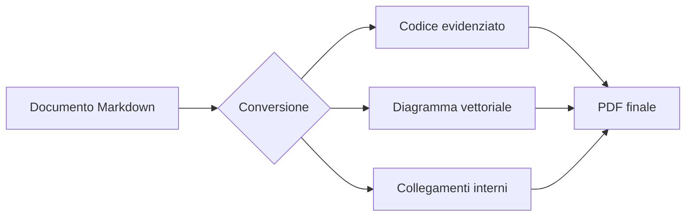

# Nuove funzionalità di mdink

Questo documento mostra le nuove funzionalità disponibili nella conversione da Markdown a PDF.

## Indice

- [Evidenziazione del codice](#evidenziazione-del-codice)
- [Diagramma Mermaid](#diagramma-mermaid)
- [Collegamenti interni](#collegamenti-interni)

## Evidenziazione del codice

Un blocco Rust con parole chiave, stringhe e commenti:

```rust
// Calcola un saluto personalizzato.
fn saluta(nome: &str) -> String {
    let messaggio = format!("Ciao, {nome}!");
    println!("{messaggio}");
    messaggio
}
```

Un esempio in Python:

```python
def fibonacci(n):
    a, b = 0, 1
    for _ in range(n):
        yield a
        a, b = b, a + b

print(list(fibonacci(8)))
```

## Diagramma Mermaid



## Collegamenti interni

I collegamenti nell'indice portano direttamente alla sezione corrispondente. Puoi anche [tornare all'indice](#indice) oppure [tornare all'inizio](#nuove-funzionalità-di-mdink).
