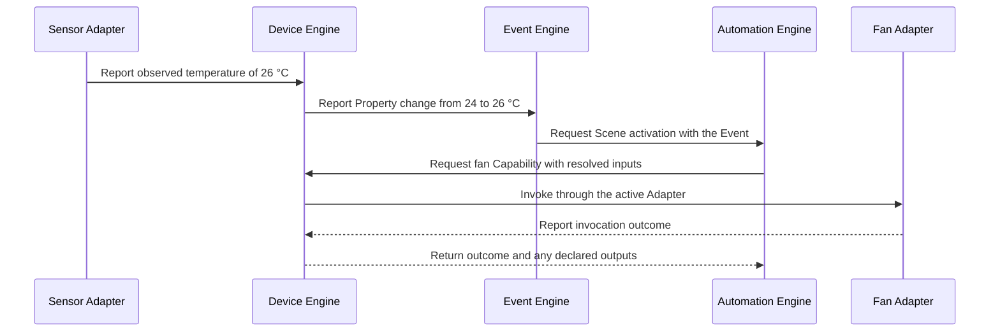

# Tutte le novità di mdink

Questa dimostrazione raccoglie le nuove funzionalità disponibili nella conversione Markdown → PDF. L'indice all'inizio è cliccabile; i titoli sono disponibili anche come segnalibri nel lettore PDF.

## Navigazione interna

Segui questi collegamenti per andare direttamente agli esempi:

- [Evidenziazione del codice](#evidenziazione-del-codice)
- [Diagrammi Mermaid](#diagrammi-mermaid)
- [Interruzioni e pagine personalizzate](#interruzioni-e-pagine-personalizzate)

<!-- pagebreak -->

## Evidenziazione del codice

I blocchi di codice riconoscono il linguaggio indicato. Questo documento usa il tema scuro, selezionato con `--code-theme dark`.

```rust
// Una semplice funzione Rust.
fn saluta(nome: &str) -> String {
    format!("Ciao, {nome}!")
}

fn main() {
    println!("{}", saluta("mdink"));
}
```

```python
def fibonacci(n):
    a, b = 0, 1
    for _ in range(n):
        yield a
        a, b = b, a + b

print(list(fibonacci(8)))
```

[Torna alla navigazione](#navigazione-interna).

<!-- pagebreak -->

## Diagrammi Mermaid

I diagrammi sono disegnati come grafica vettoriale direttamente nel PDF.



<!-- pagebreak -->

## Interruzioni e pagine personalizzate

Ogni sezione di questa dimostrazione inizia su una pagina nuova grazie a `--page-breaks` e al marcatore `<!-- pagebreak -->` scritto su una riga autonoma.

L'intestazione è stata impostata con `--header`, mentre il piè di pagina usa `--footer` e mostra il numero della pagina e il totale. L'indice è generato con `--toc` e i segnalibri con `--bookmarks`.

[Torna all'inizio](#tutte-le-novità-di-mdink).
